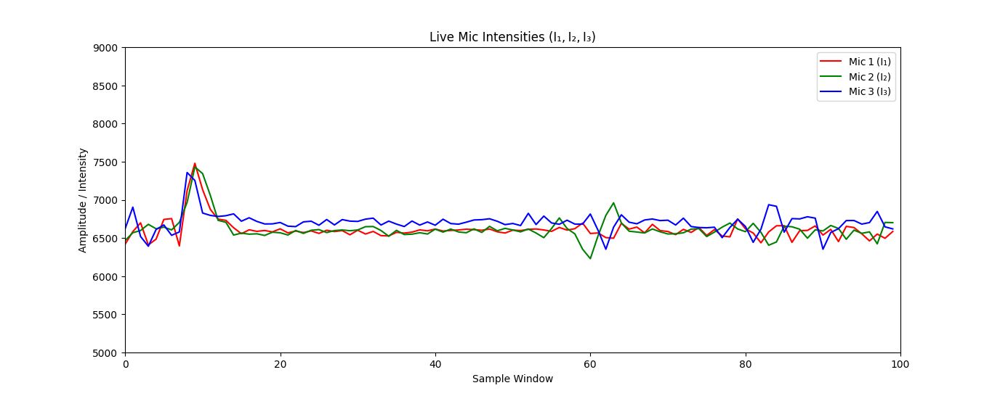

# ATTIS – Acoustic Tracking and Target Identification System

ATTIS estimates the direction a sound is coming from. It uses three microphones placed at the corners of a triangle. An ESP32 reads the three mics and streams the readings to a PC. A Python script then compares how loud each mic is and prints the direction of the source (angle and compass direction), with a live plot of the signals.



## Hardware

| Part | Purpose |
|---|---|
| ESP32 dev board | Reads the mics and sends data over USB serial (115200 baud) |
| 3 × MAX9814 microphone amplifier modules | Microphones with automatic gain control |
| ADS1115 16-bit ADC (I²C) | Final version: more precise readings than the ESP32's built-in ADC |

**Wiring (final version):** ADS1115 SDA/SCL → ESP32 I²C pins (GPIO21/GPIO22 by default). Mic 1 → A0, Mic 2 → A1, Mic 3 → A2. Mics are placed at 0°, 120° and 240° around the centre (Mic 1 points East/+X).

MAX9814 datasheet: <https://www.analog.com/media/en/technical-documentation/data-sheets/MAX9814.pdf>

## Folder structure

```
Codefiles/
├── firmware/                      Arduino sketches for the ESP32
│   ├── attis_3mic_ads1115/        ★ FINAL – 3 mics via ADS1115
│   ├── attis_3mic_esp32_adc/      earlier – 3 mics on ESP32 ADC pins
│   └── single_mic_reader/         single-mic test / data collection
├── python/                        PC-side scripts
│   ├── attis_direction.py         ★ FINAL – live direction estimation + plot
│   ├── live_mic_plot.py           live plot of the 3 mics (calibration)
│   └── record_audio.py            record serial audio from the ESP32 to WAV
├── data/
│   ├── recordings/                WAV files recorded from the ESP32
│   ├── mic_readings.xlsx          raw single-mic ADC readings
│   └── sample.wav                 sample audio clip
├── results/
│   └── live_mic_intensities_raw.png
├── requirements.txt
└── README.md
```

## What each file does

### Firmware (`firmware/`)

| File | Description |
|---|---|
| `attis_3mic_ads1115/attis_3mic_ads1115.ino` | **Final firmware.** Reads the 3 mics through the ADS1115 (default gain, ±6.144 V, 0.1875 mV/bit) and prints `mic1,mic2,mic3` per line. Requires the *Adafruit ADS1X15* library. |
| `attis_3mic_esp32_adc/attis_3mic_esp32_adc.ino` | Earlier version that reads the 3 mics directly on ESP32 pins GPIO32/34/35. It also prints two fixed reference values (2000, 8000) so the Arduino Serial Plotter's axis stays steady. |
| `single_mic_reader/single_mic_reader.ino` | Reads one MAX9814 on GPIO32 and prints each ADC value (0–4095) as text. Used for the first mic tests and for collecting `mic_readings.xlsx`. |

### Python (`python/`)

| File | Input | Output |
|---|---|---|
| `attis_direction.py` | `mic1,mic2,mic3` lines from `attis_3mic_ads1115` | Console: elapsed time, compass direction, angle (0–360°) and corrected intensities, printed every 0.5 s. Live plot of the 3 baseline-corrected signals. With `--save-plot FILE`, the final plot is also saved as an image. |
| `live_mic_plot.py` | Same serial stream | Live plot of the 3 mic signals: raw by default, or baseline-corrected with `--calibrated`. Used to find the baseline (silence) value of each mic. `results/live_mic_intensities_raw.png` was made with this script. |
| `record_audio.py` | Raw binary 16-bit samples from the ESP32 | `esp32_recording_YYYYMMDD_HHMMSS.wav` (mono, 16-bit). By default it converts 12-bit ADC values to centred 16-bit PCM; `--raw` saves the bytes unchanged. |

**How direction is calculated** (`attis_direction.py`):
1. Subtract each mic's baseline (silence) reading: 6600 for mics 1 and 2, and 6700 − 75 for mic 3, which idles slightly higher.
2. Treat each mic as a vector pointing at its position on the triangle (0°, 120°, 240°), with length equal to its corrected intensity.
3. Add the three vectors. The angle of the sum is the source direction, and it is mapped to one of 8 compass directions (0° = East, 90° = North).

### Data (`data/`)

| File | Description |
|---|---|
| `recordings/esp32_audio_*.wav` | First recordings: 16 kHz mono, raw samples (1.3–10 s). |
| `recordings/esp32_recording_20251014_0054..0108*.wav` | 16 kHz mono, 4 s, with 12-bit → 16-bit conversion. |
| `recordings/esp32_recording_20251014_0126..0129*.wav` | 5 kHz mono, 4 s (sample-rate test). |
| `recordings/esp32_recording_20251014_014346.wav` | 65 kHz mono, 4 s (sample-rate test). |
| `mic_readings.xlsx` | Raw ADC readings from a single MAX9814, collected with `single_mic_reader`. There are 8 sheets, one test run per sheet. |
| `sample.wav` | Sample audio clip (16 kHz, stereo, 15 s). |

### Results (`results/`)

| File | Description |
|---|---|
| `live_mic_intensities_raw.png` | Raw ADS1115 readings of all three mics. All three idle at ~6600 counts, with mic 3 sitting ~100 counts higher (this is why mic 3 gets the extra correction). The spike near sample 10 is a sound event picked up by all mics. |

## How to run

1. **Flash the firmware:** open `firmware/attis_3mic_ads1115/attis_3mic_ads1115.ino` in the Arduino IDE. Install *Adafruit ADS1X15* from the Library Manager, select your ESP32 board and upload.
2. **Install the Python dependencies:**
   ```bash
   pip install -r requirements.txt
   ```
3. **Find your serial port** (Device Manager on Windows, e.g. `COM9`) and close the Arduino Serial Monitor so the port is free.
4. **Run:**
   ```bash
   cd python
   python live_mic_plot.py --port COM9            # check that all three mics respond
   python attis_direction.py --port COM9          # direction estimation
   python attis_direction.py --port COM9 --duration 30 --save-plot plot.png
   ```
   Every script has `--help` for all options. The defaults (port, run time, baselines) are set at the top of each file.

> **Recalibrate baselines for your setup:** run `live_mic_plot.py` in silence. Read the idle level of each mic and update `BASELINE_I12`, `BASELINE_I3` and `I3_SHIFT_CORRECTION` in `attis_direction.py` and `live_mic_plot.py`.

## Known limitations / future work

- Direction is estimated from one reading per mic at each print interval, so the output is noisy. Averaging the RMS over a short window (or using time-difference-of-arrival between mics) would give more stable results.
- The ADS1115 reads channels one after another at ≤860 samples/s, so the three mics are not sampled at exactly the same instant.
- At 115200 baud the serial link can carry at most ~5,700 16-bit samples/s. Recordings at a higher sample rate need a faster baud rate, or they will play back at the wrong speed.
- The firmware that streamed binary audio for `record_audio.py` is not included. `single_mic_reader` prints text instead.
