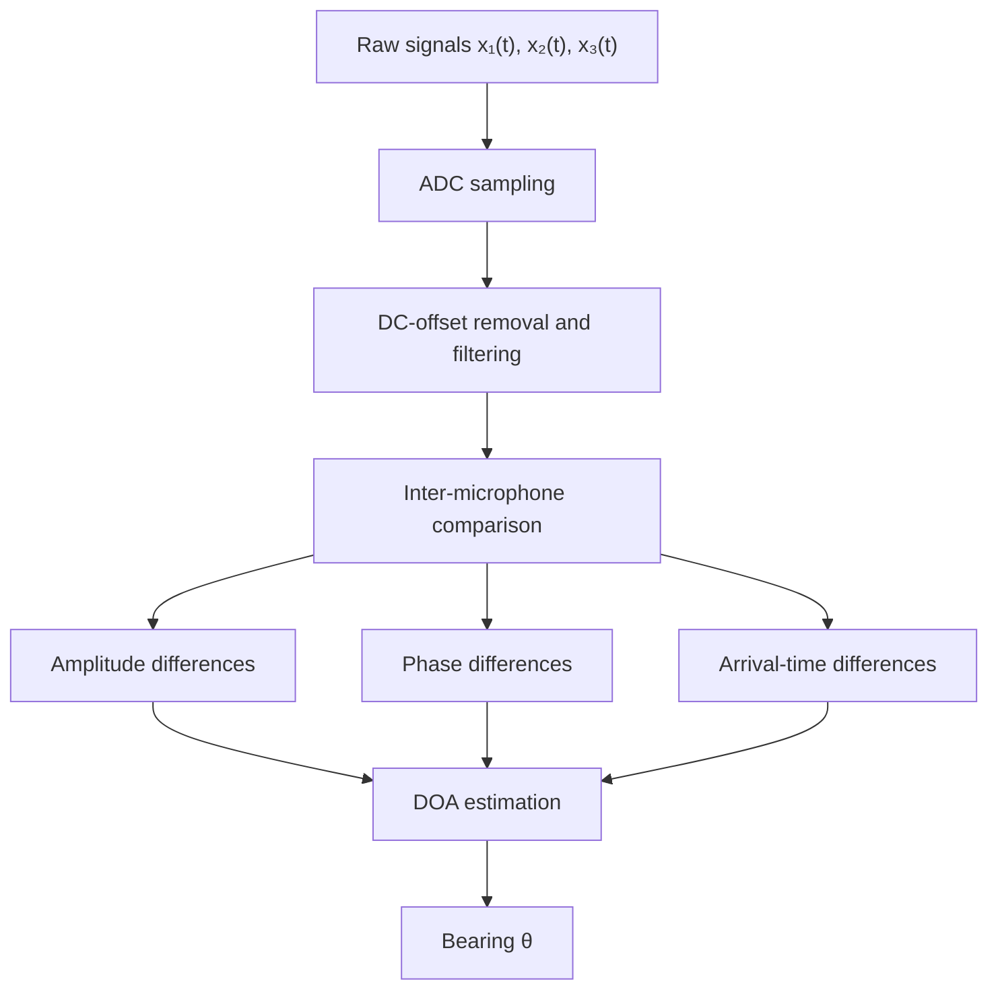
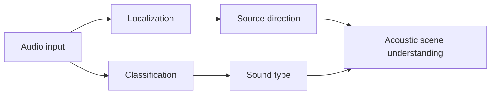
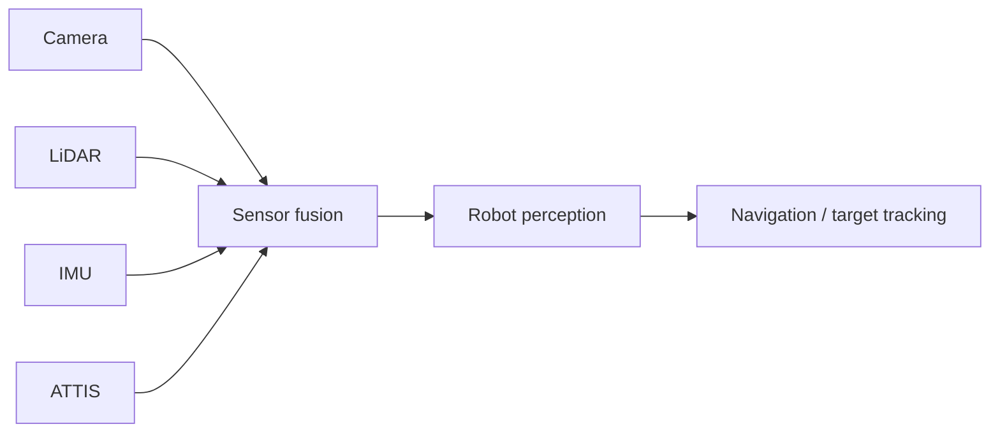

# ATTIS: Acoustic Tracking and Target Identification System

**A low-cost embedded acoustic perception module that estimates the direction of a sound source in real time using a three-microphone array and an ESP32.**

| Platform | Sensors | Method | Range | Accuracy |
|---|---|---|---|---|
| ESP32-WROOM | 3 x MAX9814 | Direction-of-Arrival (DOA) estimation | ~1.5–2 m | ~±15–25° |

---

## Table of Contents

1. [Overview](#overview)
2. [Motivation](#motivation)
3. [Problem Statement](#problem-statement)
4. [System Architecture](#system-architecture)
5. [Hardware](#hardware)
6. [Localization Principle](#localization-principle)
7. [Signal Processing Pipeline](#signal-processing-pipeline)
8. [Embedded Implementation](#embedded-implementation)
9. [Getting Started](#getting-started)
10. [Experimental Setup](#experimental-setup)
11. [Results](#results)
12. [Challenges and Engineering Trade-offs](#challenges-and-engineering-trade-offs)
13. [Limitations](#limitations)
14. [Roadmap](#roadmap)
15. [Potential Applications](#potential-applications)
16. [Repository Structure](#repository-structure)
17. [Technology Stack](#technology-stack)
18. [My Contributions](#my-contributions)
19. [Key Takeaways](#key-takeaways)
20. [Author](#author)
21. [License](#license)

---

## Overview

ATTIS is a proof-of-concept acoustic localization system built from inexpensive, off-the-shelf components. Three MAX9814 microphone modules, arranged in a triangular array roughly 120° apart, feed an ESP32 microcontroller. The ESP32 samples all three channels, compares the signals across the array, and estimates the bearing **θ** of the incoming sound.

The entire pipeline, from acquisition to direction estimate, runs on the microcontroller with no host computer in the loop. That makes ATTIS a practical starting point for an acoustic perception module on mobile robots and drones.


---

## Motivation

Most autonomous systems perceive the world through cameras and other line-of-sight sensors. These degrade sharply in:

- darkness or poor visibility
- smoke, dust, or fog
- cluttered scenes with occlusions
- confined, collapsed, or underground spaces

Sound behaves differently. It diffracts around obstacles and does not need a clear visual path to its source. A robot in a disaster zone could use acoustic cues such as voices, knocking, alarms, or machinery to decide where to search next, even when its cameras see nothing useful.

ATTIS was built to answer a focused question: **can a low-cost embedded microphone array produce directional information that is useful in real time?**

---

## Problem Statement

Design an embedded system that can:

1. Acquire audio simultaneously from multiple spatially separated microphones.
2. Process those signals in real time on a microcontroller.
3. Compare the signals received at each microphone.
4. Estimate the direction of arrival of the sound.
5. Report that direction in a form a downstream system (a human operator or a robot controller) can use.

The design was kept compatible with future integration into autonomous robotic platforms.

---

## System Architecture

| Subsystem | Role |
|---|---|
| **Acoustic sensing** | Three MAX9814 modules at ~120° spacing provide spatially distributed audio measurements. |
| **Signal acquisition** | Microphone outputs connect to the ESP32 analog inputs and are sampled continuously. |
| **Processing and localization** | Signals are filtered and compared across channels. Differences in amplitude, phase, and arrival time encode the source direction. |
| **Reporting** | The direction estimate is converted into low-latency output (serial, with wireless planned). |

### Array Geometry

```text
                MIC 1
                  ●
                 / \
                /   \
               /  ●  \        ● (centre) = array reference point
              /       \
             /         \
            ●───────────●
         MIC 2         MIC 3

           ~120° angular spacing
```

A triangular layout gives three independent microphone pairs (1–2, 2–3, 3–1). With only two microphones, a source in front of the pair is indistinguishable from its mirror image behind it. The third microphone breaks this front-back ambiguity and allows a full 360° bearing estimate in the horizontal plane.

---

## Hardware

### Bill of Materials

| Component | Qty | Purpose |
|---|:-:|---|
| ESP32-WROOM development board | 1 | Acquisition, processing, direction estimation |
| MAX9814 microphone module (electret + AGC amplifier) | 3 | Acoustic signal acquisition |
| Acoustic receiver structure | 1 | Fixes microphone positions and spacing |
| Breadboard | 1 | Prototype assembly |
| Jumper wires | – | Interconnects |
| Power supply | 1 | System power |

### Electrical Architecture

```text
┌─────────────┐
│ MAX9814 #1  │──┐
└─────────────┘  │       ┌───────────────────────────┐
┌─────────────┐  │       │   ESP32 (ADC inputs)      │
│ MAX9814 #2  │──┼──────►│   - signal acquisition    │
└─────────────┘  │       │   - filtering             │
┌─────────────┐  │       │   - direction estimation  │
│ MAX9814 #3  │──┘       └─────────────┬─────────────┘
└─────────────┘                        │
                                       ▼
                                Direction output
```

### Wiring

<!-- TODO: Fill in from firmware. Prefer ADC1 pins (GPIO32–39); ADC2 is unavailable while Wi-Fi is active. -->

| Signal | ESP32 pin |
|---|---|
| MAX9814 #1 OUT | GPIO__ |
| MAX9814 #2 OUT | GPIO__ |
| MAX9814 #3 OUT | GPIO__ |
| VDD | 3.3 V |
| GND | GND |

> **Design note:** The MAX9814 has built-in automatic gain control (AGC). AGC adjusts each module's gain independently, which can distort amplitude comparisons between channels. Setting all three modules to the same fixed gain (via the GAIN pin) makes amplitude-based cues more consistent.

---

## Localization Principle

A sound wave from a distant source reaches the array as an approximately planar wavefront. Because the microphones sit at different positions, each one receives the same acoustic event with small differences in:

- **Arrival time:** the wavefront reaches the nearest microphone first.
- **Phase:** for a periodic signal, the arrival-time difference appears as a phase offset.
- **Amplitude:** the nearer microphone typically sees a slightly stronger signal, especially at short range.

For a pair of microphones separated by distance *d*, a far-field source at angle θ from the pair's axis produces a time difference of arrival (TDOA) of

$$
\Delta t = \frac{d \cos\theta}{c}
$$

where *c* ≈ 343 m/s is the speed of sound in air. Inverting this for each microphone pair, and combining the three pairwise estimates, yields the source bearing.

### Practical implications

- **Delays are tiny.** With 10 cm spacing, the largest possible delay is about 0.29 ms. Resolving it requires a high sampling rate and tight timing between channels.
- **Spacing and wavelength are coupled.** If the spacing exceeds half the sound's wavelength, phase cues become ambiguous (spatial aliasing). Larger arrays give finer angular resolution but a lower usable frequency ceiling.
- **Near-field sources break the planar assumption.** At very short range, the wavefront is curved and the simple formula above loses accuracy.

The current firmware combines inter-microphone signal characteristics in a proof-of-concept estimator. More rigorous TDOA and frequency-domain methods are on the [roadmap](#roadmap).

---

## Signal Processing Pipeline



---

## Embedded Implementation

The ESP32 is responsible for:

- sampling all three microphone channels continuously
- conditioning the sampled signals
- comparing signals across the array
- computing the direction estimate
- emitting the result over serial

Running the full loop on-device keeps latency low and removes the need for a tethered computer, which is essential for eventual deployment on a mobile platform.

### Development Workflow

```text
Microphone selection
  → Array geometry design
  → Hardware integration
  → ESP32 signal acquisition
  → Signal processing
  → Direction estimation
  → Controlled experiments
  → Performance evaluation
```

---

## Getting Started

<!-- TODO: Adjust paths and settings to match the repository. -->

### Prerequisites

- Arduino IDE (or PlatformIO) with the ESP32 board package installed
- ESP32-WROOM development board
- Three MAX9814 modules wired as described in [Wiring](#wiring)

### Build and Flash

1. Clone the repository:
   ```bash
   git clone https://github.com/<username>/ATTIS.git
   ```
2. Open the firmware in `src/`.
3. Select the **ESP32 Dev Module** board and the correct COM port.
4. Upload the firmware.
5. Open the serial monitor at the configured baud rate to view direction estimates.

### Usage

Place the array on a flat surface away from walls, produce a sound (clap, tone, or speech) at a known angle, and read the estimated bearing from the serial output.

---

## Experimental Setup

A sound source was placed at controlled angular positions around the array, and the estimated bearing was compared against the true bearing.

```text
              Sound source
                   ●
                  /
                 /  θ (true bearing)
                /
               ▼
      ┌──────────────────┐
      │ Microphone array │
      └──────────────────┘
```

Evaluation covered:

- directional accuracy across multiple source angles
- usable operating range
- sensitivity to background noise
- variation between individual microphone modules
- effect of array geometry
- real-time responsiveness

---

## Results

| Metric | Result |
|---|---|
| Operating range | ~1.5–2 m |
| Directional accuracy | ~±15–25° |
| Processing | Real-time, fully on-device |
| Platform | ESP32 |
| Array | 3-channel triangular |

The prototype reliably distinguished between source directions in controlled indoor conditions. This confirms that a compact, low-cost microphone array can act as a coarse directional acoustic sensor, which is sufficient for tasks such as orienting a robot toward a sound before handing off to finer sensors.

<!-- TODO: Add a plot of estimated vs. true bearing and a photo of the prototype in media/. -->

---

## Challenges and Engineering Trade-offs

| Challenge | Description | Mitigation / Direction |
|---|---|---|
| **Microphone mismatch** | Modules differ in sensitivity, and AGC changes gain per channel. | Per-channel calibration; fixed-gain configuration. |
| **ADC limitations** | The ESP32's onboard ADC is noisy and somewhat non-linear. | Calibration curves, oversampling, or an external ADC / I²S digital microphones. |
| **Inter-channel timing skew** | A single multiplexed ADC samples channels one after another, adding a small artificial delay between them. | Compensate in software, or use simultaneously sampled inputs (I²S MEMS mics). |
| **Environmental noise** | Background sound masks or biases the target signal. | Band-pass filtering, FFT-based processing, sound classification. |
| **Reverberation** | Reflections from walls create multiple arrival paths and false bearings. | Onset detection, GCC-PHAT, and other robust TDOA methods. |
| **Array geometry** | Spacing trades angular resolution against size and aliasing frequency. | Co-design geometry with the target sound band and platform size. |

---

## Limitations

- Characterized in controlled indoor settings only; performance in open or highly reverberant spaces has not been quantified.
- Designed for a single dominant source; simultaneous sources are not separated.
- Estimates bearing (azimuth) only, not elevation or range.
- Accuracy of ±15–25° suits coarse orientation, not precise targeting.

---

## Roadmap

### 1. Frequency-Domain Processing
FFT-based analysis to isolate dominant frequencies and suppress out-of-band noise.

```text
Time-domain signal → FFT → Spectrum → Target-band selection
```

### 2. Improved Localization Algorithms
- Cross-correlation-based TDOA
- GCC-PHAT for robustness to reverberation
- Delay-and-sum and adaptive beamforming
- Multi-source localization

### 3. Hardware Upgrades
- I²S MEMS microphones for simultaneous, digitally sampled channels
- A rigid, precisely dimensioned array mount
- A fourth microphone for elevation estimation

### 4. Sound Classification
Pair localization with lightweight ML classification so the system reports both *where* a sound is and *what* it is.



### 5. Closed-Loop Sound Tracking
Mount ATTIS on a mobile robot and use the bearing estimate to rotate and drive toward the source, updating continuously.


### 6. Wireless Output and Sensor Fusion
Stream bearings over Wi-Fi or ESP-NOW to a higher-level controller (for example, a ROS 2 node) and fuse them with camera, LiDAR, IMU, ultrasonic, and GNSS data.



### Long-Term Vision
Evolve ATTIS from a direction detector into a complete acoustic perception module: localization and classification feeding a multimodal perception stack that drives navigation and target tracking.

---

## Potential Applications

- **Search and rescue:** locate voices or tapping in collapsed structures, smoke-filled rooms, and underground spaces.
- **Autonomous robotics:** an acoustic sensing channel for robots and drones operating where vision is unreliable.
- **Industrial monitoring:** detect abnormal machinery sounds and localize their origin.
- **Wildlife monitoring:** locate animal calls in dense or low-visibility habitats.
- **Smart infrastructure:** distributed acoustic nodes for spatial event detection.

---

## Repository Structure

<!-- TODO: Update to match the actual repository layout. -->

```text
ATTIS/
├── src/          ESP32 firmware
├── data/         Experimental recordings and measurements
├── analysis/     Evaluation and plotting scripts
├── hardware/     Schematics and array mechanical design
├── media/        Photos and demonstration videos
└── README.md
```

---

## Technology Stack

**Hardware:** ESP32-WROOM, 3 x MAX9814 microphone modules, custom array structure

**Software:** Embedded C/C++, Arduino framework for ESP32, serial communication

**Concepts:** Microphone arrays, direction-of-arrival estimation, TDOA, digital signal processing, real-time data acquisition, sensor integration, robotic perception, sensor fusion

---

## My Contributions

**Hardware integration**
- Designed and assembled the three-microphone acquisition system.
- Integrated the MAX9814 modules with the ESP32.
- Determined microphone placement and performed system calibration.

**Embedded development**
- Implemented real-time multi-channel signal acquisition on the ESP32.
- Built the on-device signal-processing pipeline.
- Implemented cross-channel signal comparison logic.

**Acoustic localization**
- Developed the direction-estimation logic from inter-microphone signal characteristics.
- Investigated the effects of noise, microphone mismatch, and array geometry.

**Validation**
- Designed and ran controlled experiments to measure accuracy and operating range.
- Characterized the practical limits of a low-cost microphone-array architecture.
- Documented system-level trade-offs to guide future robotic integration.

---

## Key Takeaways

ATTIS traces the complete chain from physics to perception:

**Physical sensing → Embedded acquisition → Signal processing → Spatial inference → Robotic perception**

It shows that a deliberately simple, inexpensive sensor configuration can be engineered into a working real-time perception system, and it exposes the real constraints (ADC quality, timing, mismatch, reverberation) that any serious acoustic localization system has to solve.

A detailed project report covering problem formulation, hardware design, methodology, experimental results, limitations, and the development roadmap accompanies this repository.


## License

This project is intended for academic and educational use. If you use or build on this work, please provide appropriate attribution.

<!-- Consider adding a formal license file (e.g. MIT) so the terms are unambiguous. -->
